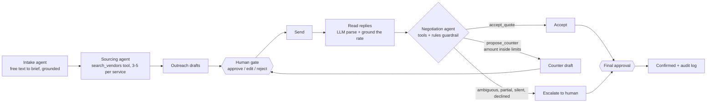

# Msafara

**Vendor coordination for tour operators and DMCs. Agents do the chasing, quoting and negotiating; a human approves every message that leaves the building.**


> 📘 **[Product case study on Notion](https://fern-appliance-85f.notion.site/3ebefd17b766814b8760e8717345b4a7)** · **[Live demo](https://pryank18.github.io/Msafara/)** · **Docs:** [PRD](docs/PRD.md) · [BRD](docs/BRD.md) · [MRD](docs/MRD.md) · [Spec](docs/product-spec.md) · **More work:** [Notion portfolio](https://fern-appliance-85f.notion.site/Pryank-Wadhera-3eaefd17b76680c88283e85a3217ff52)

A trip request arrives as free text. LLM agents read it into a brief, search the vendor knowledge base and shortlist three to five vendors per service (hotel, transport, activity), draft the outreach, read the replies, and decide whether to accept, counter or escalate, choosing the counter amount themselves. They act by calling tools, and every tool checks its own limits in code. A rules engine runs alongside as the guardrail and takes over if the model fails. Every outbound message waits at a gate where the operator can approve, edit or reject it.

## See it

| Approve before anything is sent | Confirmed after two negotiation rounds |
|---|---|
|  |  |

Each service shows its stage, a one-line reason for the decision and a confidence label. The audit log underneath records every agent action and every human decision. More views: [Evals](docs/screenshots/trip-desk-evals.png) · [Knowledge search](docs/screenshots/trip-desk-knowledge.png).

## How a trip moves



One shared trip state flows through a single router node, so every decision is visible in one place. Human gates use LangGraph interrupts, and the graph resumes from the saved checkpoint.

## Agents and tools

| Agent | What the model decides | Tools it calls | What code still enforces |
|---|---|---|---|
| Intake | every field of the brief from messy free text | (structured output) | each value must appear in the request text, or it is cleared and the trip escalates |
| Sourcing | which 3-5 vendors to ask | `search_vendors`, `select_vendors` | city, category, star, capacity and blacklist are applied inside the search; only returned vendors can be selected |
| Reply reading | status, tax-inclusive rate, availability, whether our counter was accepted | (structured output, with the thread so far) | the rate must be traceable to the reply text; instructions inside a reply are flagged |
| Negotiation | accept, counter (and the amount and wording), or escalate | `check_vendor_status`, `get_price_history`, `get_price_limits`, `propose_counter`, `accept_quote`, `escalate_to_human` | counters outside the allowed range are refused; accepts above the ceiling are refused; replies the policy sends to a human allow only `escalate_to_human` |
| Outreach | wording of each request | (structured output) | any price not on file, the floor or internal terms swaps the text for a template |

Tool calling is native on all three backends (a messages-style API, a local model server, a hosted generateContent-style API) behind one loop in `msafara/llm.py`. A refused tool call goes back to the model as an error it can correct. If no decision arrives within the step limit, the rules engine decides instead, and the trip records it. No tool can send anything: a counter is a draft until a person approves it.

## Results: LLM agents vs rules

<!-- RESULTS:START -->

On 100 synthetic trips (25 core + 75 messy or adversarial), same simulated vendors and checks for both columns.

| Metric | Rules engine | LLM agents + rules guardrails |
|---|---|---|
| Task completion (right end state, no breach) | 86.0% | 100% |
|   core 25 trips | 100% | 100% |
|   75 messy / adversarial trips | 81.3% | 100% |
| Strict pass: every check incl. message wording | 9.0% | 17.0% |
| Intake field accuracy | 97.4% | 99.9% |
| Intake exact (all 8 fields right) | 90.0% | 99.0% |
| Intake, 12 held-out phrasings (field accuracy) | 91.7% | 100% |
| Price-limit violations | 4 | 0 |
| Sends without approval (must be 0) | 0 of 1,168 | 0 of 1,183 |
| Escalation precision / recall (trip) | 0.87 / 0.90 | 1.00 / 1.00 |
| Escalation precision / recall (service) | 0.93 / 0.91 | 1.00 / 1.00 |
| Vendor-reply parse accuracy | 98.0% | 99.9% |
| Outbound message quality (same model judge, both columns) | 27.2% | 76.8% |
| Model calls per trip | 0 | 32.7 |
| Tokens per trip (in / out) | 0 / 0 | 52,585 / 12,890 |
| Cost per trip | $0 | $0.0117 |
| Wall time per trip | 0.5 s | 73.6 s |

Runs: rules 2026-10-20; LLM agents 2026-10-20 (small hosted LLM). Method, caveats and how to reproduce: [docs/eval-results.md](docs/eval-results.md).

<!-- RESULTS:END -->

## What it will not do

These limits are enforced in code and re-checked by the eval suite, not requested in a prompt.

| Rule | How it is enforced |
|---|---|
| Never counter more than **10%** below a vendor's quote | `compute_counter` caps the discount; `assert_counter_bounds` raises `BoundViolation` |
| Never go below the vendor's **floor** | the floor is read from the rate card, and the counter is `max(quote x (1 - d), floor)` |
| At most **2** negotiation rounds | `HARD_MAX_ROUNDS`; the human's own edits are held to the same limits |
| Never send without approval | one send function raises `UnapprovedSend` unless the draft is approved |
| Never state an amount it cannot source | outgoing text is checked; ungrounded currency, floor disclosure and internal terms are rejected and replaced with a template |
| Never trust a parsed rate blindly | a rate must be traceable to the reply text, otherwise the quote is downgraded to ambiguous |
| Never guess | ambiguity, partial answers, unclear tax, low parse confidence, no reply and over-anchor quotes all escalate |

## Retrieval

Eighty fictional vendors across Jaipur, Goa, Zanzibar and Arusha (INR and USD), with rate cards, past quotes, negotiation logs and operator policies, cut into 442 chunks and indexed in Chroma. Matching is a metadata filter (city, capacity, blacklist, currency) followed by a semantic rank. Anchors, floors and negotiation history come only from retrieved chunk metadata, so a figure in a draft can be traced to its source.

The embedder is a lexical hashing embedder, so the demo needs no model download. It is deliberately simple and swappable. Without Chroma installed, a numpy backend gives identical results under the same filters (tested).

## Evals

The results table above comes from `python -m msafara.evals.results`, which reads the run log. Method, the 75 extra trips and caveats: [docs/eval-results.md](docs/eval-results.md). Sabotage tests prove each metric can fail, and a scripted hostile model tries to break every limit through the tools (`msafara/tests/test_tool_agents.py`), so a pass means something.

## Prompts

`msafara/prompts/` holds versioned prompts (intake v1-v3, sourcing, negotiation, outreach, quote parsing v1-v2, counter, judge) with an `active.json` switch and a [CHANGELOG](msafara/prompts/CHANGELOG.md). Structured output is validated against Pydantic schemas with one retry; tool arguments are validated by the tools. If the model still fails, the rules engine takes that step.

Run the prompt-version comparison on a free backend (a model server on your own machine, or a free hosted-model API key):

```bash
export MSAFARA_LLM_PROVIDER=local MSAFARA_MODEL=<your local model tag>   # or a hosted key: see msafara/README.md
bash scripts/run_prompt_eval.sh
```

Runs are appended to `msafara/evals/runs.jsonl` with a generic model class; the exact model id stays in a git-ignored local log. A Colab notebook in `notebooks/` does the same with nothing to install.

## Run it

```bash
pip install -r requirements-msafara.txt
python -m pytest -q                                   # 102 tests, no API key needed
python -m msafara.evals.run --workers 8 --label "my run"   # 100 trips + held-out intake
python -m msafara.evals.run --report
python -m msafara.evals.results                       # rebuild the results table from the log
```

## Repo map

| Path | What is in it |
|---|---|
| `msafara/graph.py` | LangGraph workflow, human gates, SQLite checkpointing |
| `msafara/agents.py` | intake, sourcing and negotiation agents, outreach, parsing, rules engine, guardrails |
| `msafara/tools.py` | the tools the agents call, with their limits |
| `msafara/llm.py` | model backends, native tool calling, the agent loop, usage meter |
| `msafara/rag.py`, `kb.py`, `seed_kb.py` | chunking, embeddings, Chroma and numpy index, synthetic knowledge base |
| `msafara/evals/` | 100 cases, metrics, parallel runner, run history, results page |
| `msafara/prompts/` | versioned prompts and changelog |
| `msafara/simulator.py` | deterministic vendor simulator |
| `msafara/tests/` | 102 tests |
| `msafara/api.py` | FastAPI router that serves the Trip Desk |
| `index.html`, `demo-api.js` | in-browser demo on GitHub Pages |
| `graph.py`, `storage.py`, `dispatch.py`, `inbox_poll.py` | the earlier request-tracking workflow |
| `docs/` | PRD, BRD, MRD, spec, screenshots |

The full FastAPI server, Trip Desk page and seeded demo database are not published here. The live demo runs the earlier request-tracking flow in the browser with sample data.

## Product decisions

- **The model decides, code holds the line.** The negotiation agent picks accept, counter or escalate and chooses the amount, but only inside limits the tools enforce, and never past a human gate.
- **Escalate ambiguity to a human.** Partial or unclear vendor replies go back to the coordinator instead of being guessed at.
- **Runs with zero API keys.** The rules engine runs the whole flow on its own, which makes it both the fallback and the baseline the agents are measured against.
- **Meet vendors where they already are.** Email and WhatsApp, not a vendor portal nobody will log into.

**How I would measure it:** concurrent requests one coordinator can run, requests that stall on unanswered silence, and time from request to client-ready proposal.

## Core capabilities

- Drafts and sends vendor requests for accommodation, transport and activities
- Follows up on silence and tracks response deadlines
- Negotiates within configurable bounded rules
- Tracks expiring holds and flags lapsed ones
- Compares competing vendors, ranked by price
- Handles multi-item replies and escalates partial or ambiguous ones
- Reopens a confirmed request for revision
- Generates client-facing proposal documents (.docx)
- Email (SMTP/IMAP) and WhatsApp (Twilio) dispatch, both optional
- Dashboard in English, Arabic (full RTL), French, Swahili and Hindi

## Configuration

| Variable | Purpose |
|---|---|
| `SMTP_HOST` / `SMTP_PORT` / `SMTP_USER` / `SMTP_PASSWORD` | Outbound email dispatch (`dispatch.py`) |
| `IMAP_HOST` / `IMAP_USER` / `IMAP_PASSWORD` | Inbound email polling (`inbox_poll.py`) |
| `LLM_API_KEY`, `LLM_API_URL`, `LLM_API_HEADERS`, `MSAFARA_MODEL` | Optional primary model backend (any messages-style API); unset runs the rules engine |
| `MSAFARA_MODEL_CLASS` | Generic model description written to the public run log |
| `MSAFARA_PRICE_IN`, `MSAFARA_PRICE_OUT` | USD per million tokens, for the cost metric |
| `MSAFARA_LLM_SOURCING`, `MSAFARA_LLM_NEGOTIATION` | Set to `0` to put that step back on the rules engine |
| `MSAFARA_JUDGE=heuristic` | Same rule-based message judge for every system (used for the comparison) |
| `MSAFARA_LLM_PROVIDER`, `MSAFARA_LLM_KEY`, `MSAFARA_HOSTED_URL`, `MSAFARA_HOSTED_MODEL` | Optional free backends: a local model server, or a hosted free-tier key |

## How it was built

Built by Pryank Wadhera. Product scope, requirements (see `docs/`) and QA are mine.

## Known limitations

- No authentication. Add an auth layer before exposing it beyond local or demo use.
- SQLite without locking, suited to single-user use.
- The embedder is lexical, and the knowledge base is synthetic.
- Currency is cosmetic in the earlier dashboard: it shows `$` whatever the stored currency.
- Vendor replies are simulated in the evals. No real vendor has been contacted.
- WhatsApp replies need a webhook receiver (not included); outbound only for now.
- One eval run per system; small run-to-run differences on the model side are expected.
- The approval gate and the limits cover the `msafara/` trip workflow. The older request-tracking flow at the repo root (`graph.py`, `dispatch.py`) sends without that gate.
- Intake grounding proves a value appears in the request, not that it was read correctly.
