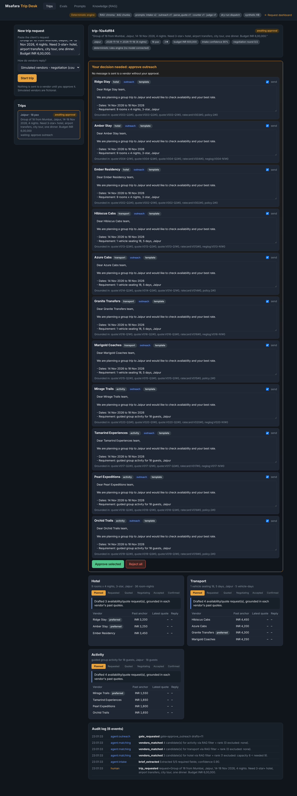
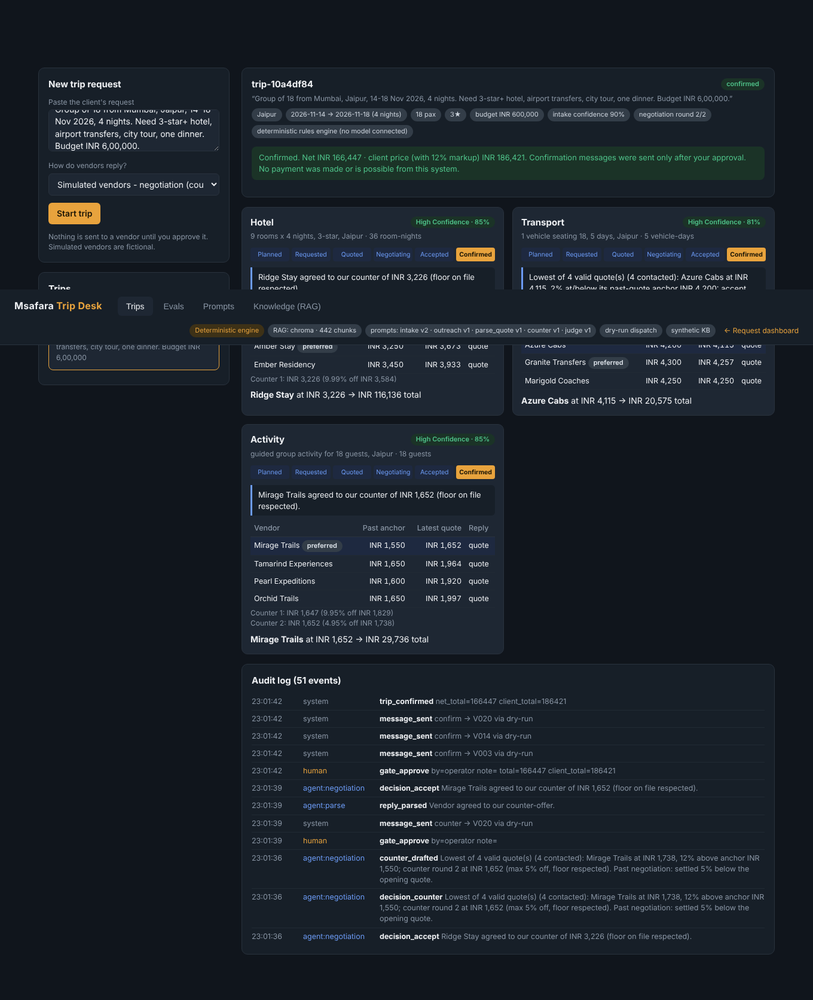
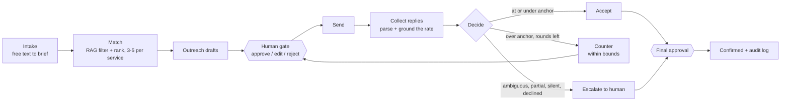

# Msafara

**Vendor coordination for tour operators and DMCs. Agents do the chasing, quoting and negotiating; a human approves every message that leaves the building.**


> 📘 **[Product case study on Notion](https://fern-appliance-85f.notion.site/3ebefd17b766814b8760e8717345b4a7)** · **[Live demo](https://pryank18.github.io/Msafara/)** · **Docs:** [PRD](docs/PRD.md) · [BRD](docs/BRD.md) · [MRD](docs/MRD.md) · [Spec](docs/product-spec.md) · **More work:** [Notion portfolio](https://fern-appliance-85f.notion.site/Pryank-Wadhera-3eaefd17b76680c88283e85a3217ff52)

A trip request arrives as free text. Msafara pulls out the brief, shortlists three to five vendors per service (hotel, transport, activity) from a knowledge base, drafts the outreach, parses the replies, counters inside hard limits, and escalates anything it should not decide. Every outbound message waits at a gate where the operator can approve, edit or reject it.

## See it

| Approve before anything is sent | Confirmed after two negotiation rounds |
|---|---|
|  |  |

Each service shows its stage, a one-line reason for the decision and a confidence label. The audit log underneath records every agent action and every human decision. More views: [Evals](docs/screenshots/trip-desk-evals.png) · [Knowledge search](docs/screenshots/trip-desk-knowledge.png).

## How a trip moves



One shared trip state flows through a single router node, so every decision is visible in one place. Human gates use LangGraph interrupts, and the graph resumes from the saved checkpoint.

## What it will not do

These limits are enforced in code and re-checked by the eval suite, not requested in a prompt.

| Rule | How it is enforced |
|---|---|
| Never counter more than **10%** below a vendor's quote | `compute_counter` caps the discount; `assert_counter_bounds` raises `BoundViolation` |
| Never go below the vendor's **floor** | the floor is read from the rate card, and the counter is `max(quote x (1 - d), floor)` |
| At most **2** negotiation rounds | `HARD_MAX_ROUNDS`; the human's own edits are held to the same limits |
| Never send without approval | one send function raises `UnapprovedSend` unless the draft is approved |
| Never state an amount it cannot source | outgoing text is checked; ungrounded currency, floor disclosure and internal terms are rejected and replaced with a template |
| Never trust a parsed rate blindly | a rate must be traceable to the reply text, otherwise the quote is downgraded to ambiguous |
| Never guess | ambiguity, partial answers, unclear tax, low parse confidence, no reply and over-anchor quotes all escalate |

## Retrieval

Eighty fictional vendors across Jaipur, Goa, Zanzibar and Arusha (INR and USD), with rate cards, past quotes, negotiation logs and operator policies, cut into 442 chunks and indexed in Chroma. Matching is a metadata filter (city, capacity, blacklist, currency) followed by a semantic rank. Anchors, floors and negotiation history come only from retrieved chunk metadata, so a figure in a draft can be traced to its source.

The embedder is a lexical hashing embedder, so the demo needs no model download. It is deliberately simple and swappable. Without Chroma installed, a numpy backend gives identical results under the same filters (tested).

## Evals

Twenty-five synthetic trips run against a deterministic vendor simulator with eleven reply behaviours (clean, negotiable, firm, ambiguous, partial, silent, declining and others), plus twelve held-out intake phrasings the parser was not tuned on.

| Metric | Result |
|---|---|
| Bound violations (independent check against knowledge-base truth) | **0** across 31 counters |
| Unapproved sends | **0** |
| Escalation precision / recall | 1.00 / 1.00 |
| Message and quote grounding | 100% |
| Intake field accuracy, 25 dev cases | v1 rules 67% to v2 rules 100% |
| Intake field accuracy, 12 held-out phrasings | v1 60.4%, v2 91.7% (8 of 12 exact) |

Sabotage tests prove each metric can fail, so a pass means something.

**Read this part:** the v1 and v2 intake rows are two rule-based parsers, not LLM prompts, and v2 was tuned on the 25 dev cases. The held-out row is the fairer number. Four held-out misses are left unfixed on purpose. No LLM run has been made yet, so prompt quality is unmeasured. The prompts are versioned and ready; see below to run them for free.

## Prompts

`msafara/prompts/` holds versioned prompts (intake v1/v2, outreach, quote parsing, counter, judge) with an `active.json` switch and a [CHANGELOG](msafara/prompts/CHANGELOG.md). Model output is validated against Pydantic schemas with one retry. If it still fails, the agent escalates to a human.

Run the prompt-version comparison on a free backend (a local Local model server model, or a free hosted-model API key):

```bash
export MSAFARA_LLM_PROVIDER=local MSAFARA_MODEL=local-model   # or: export MSAFARA_LLM_KEY=...
bash scripts/run_prompt_eval.sh
```

Runs are appended to `msafara/evals/runs.jsonl` with the model's name. A Colab notebook in `notebooks/` does the same with nothing to install.

## Run it

```bash
pip install -r requirements-msafara.txt
python -m pytest -q                         # 74 tests, no API key needed
python -m msafara.evals.run --label "my run"   # 25 trips + held-out intake
python -m msafara.evals.run --report
```

## Repo map

| Path | What is in it |
|---|---|
| `msafara/graph.py` | LangGraph workflow, human gates, SQLite checkpointing |
| `msafara/agents.py` | intake, matching, outreach, parsing, negotiation, guardrails |
| `msafara/rag.py`, `kb.py`, `seed_kb.py` | chunking, embeddings, Chroma and numpy index, synthetic knowledge base |
| `msafara/evals/` | cases, metrics, runner, run history |
| `msafara/prompts/` | versioned prompts and changelog |
| `msafara/simulator.py` | deterministic vendor simulator |
| `msafara/tests/` | 74 tests |
| `msafara/api.py` | FastAPI router that serves the Trip Desk |
| `index.html`, `demo-api.js` | in-browser demo on GitHub Pages |
| `graph.py`, `storage.py`, `dispatch.py`, `inbox_poll.py` | the earlier request-tracking workflow |
| `docs/` | PRD, BRD, MRD, spec, screenshots |

The full FastAPI server, Trip Desk page and seeded demo database are not published here. The live demo runs the earlier request-tracking flow in the browser with sample data.

## Product decisions

- **Bounded negotiation, never autonomous.** The agent counters inside operator-set rules and a capped number of rounds.
- **Escalate ambiguity to a human.** Partial or unclear vendor replies go back to the coordinator instead of being guessed at.
- **Runs with zero API keys.** A deterministic rules engine lets anyone demo the whole flow; a model switches on when one is connected.
- **Meet vendors where they already are.** Email and WhatsApp, not a vendor portal nobody will log into.

**How I would measure it:** concurrent requests one coordinator can run, requests that stall on unanswered silence, and time from request to client-ready proposal.

## Core capabilities

- Drafts and sends vendor requests for accommodation, transport and activities
- Follows up on silence and tracks response deadlines
- Negotiates within configurable bounded rules
- Tracks expiring holds and flags lapsed ones
- Compares competing vendors, ranked by price
- Handles multi-item replies and escalates partial or ambiguous ones
- Reopens a confirmed request for revision
- Generates client-facing proposal documents (.docx)
- Email (SMTP/IMAP) and WhatsApp (Twilio) dispatch, both optional
- Dashboard in English, Arabic (full RTL), French, Swahili and Hindi

## Configuration

| Variable | Purpose |
|---|---|
| `SMTP_HOST` / `SMTP_PORT` / `SMTP_USER` / `SMTP_PASSWORD` | Outbound email dispatch (`dispatch.py`) |
| `IMAP_HOST` / `IMAP_USER` / `IMAP_PASSWORD` | Inbound email polling (`inbox_poll.py`) |
| `MSAFARA_LLM_KEY`, `MSAFARA_LLM_PROVIDER`, `MSAFARA_MODEL` | Optional model backend for the Msafara workflow; unset runs the rules engine |

## How it was built

Built by Pryank Wadhera. Product scope, requirements (see `docs/`) and QA are mine.

## Known limitations

- No authentication. Add an auth layer before exposing it beyond local or demo use.
- SQLite without locking, suited to single-user use.
- The embedder is lexical, and the knowledge base is synthetic.
- Currency is cosmetic in the earlier dashboard: it shows `$` whatever the stored currency.
- Vendor replies are simulated in the evals. No real vendor has been contacted.
- WhatsApp replies need a webhook receiver (not included); outbound only for now.
- LLM prompt quality is not yet measured (see Evals).
